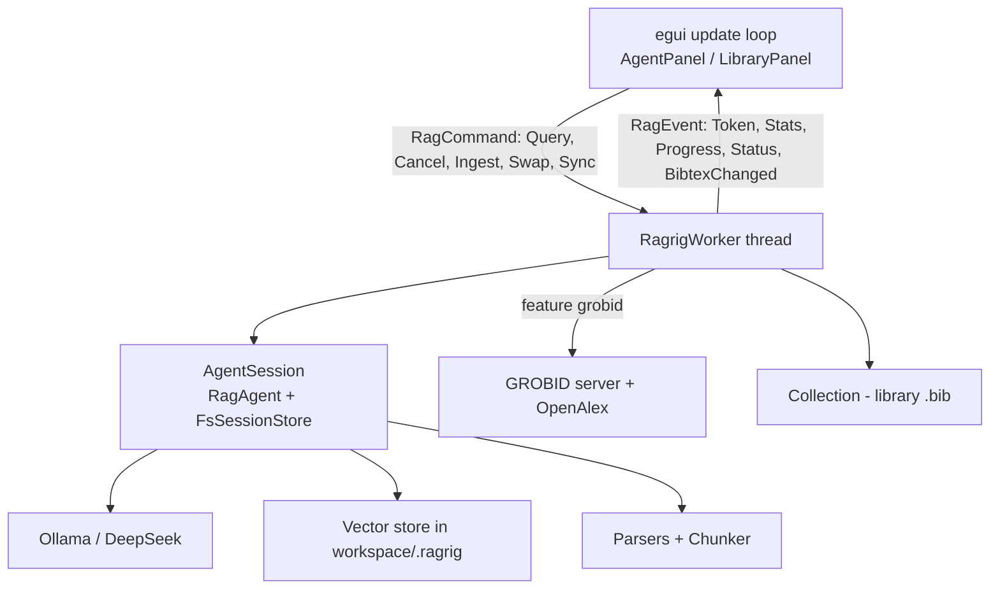

# sciscraper × ragrig — Integration Plan (Draft for Review)

**Scope:** Fresh Ferrite fork (`sciscraper-rs`, still `name = "ferrite"` v0.3.1) gains the
functionality of `ragrig-cli` as a GUI: agent chat pane, RAG component bar, bibliographic
library panel, drag-to-cite, and drop-to-ingest.
**Hard rule:** touch nothing in `ragrig-cli` / `grobid-bibtex`; work around, report upstream.
**Merge-request rule:** every new capability is behind a Cargo feature; the editor without
features behaves exactly as before.

---

## 0. Ground truth found in the repositories (2026-10)

| Area | Fact |
|---|---|
| `sciscraper-rs` | Ferrite v0.3.1, edition 2021, toolchain pinned **1.92.0**, egui/eframe 0.34 (glow). Has a worker pattern (`src/workers/`, feature `async-workers`, tokio + std::sync::mpsc, background-thread runtime). Has an **AI panel placeholder** (`settings.ai_panel_visible` + echo worker). Side panels via `egui::Panel` / `SidePanel`; popups use the egui 0.34 `Popup` API; drag-and-drop already used (tab reorder via `DragAndDrop::set_payload`, window-level `dropped_files` handling in `file_ops.rs`). i18n via rust-i18n (`locales/*.yaml`). |
| `ragrig` 1.1.1 (latest on crates.io) | `RagAgent` (builder) + `AgentSession` (Tier 2) with `chat_streaming_detailed[_with_attachments]`. `Progress`/`Cancel` traits documented **for GUI hosts** (mpsc-forward, atomic-flag cancel). `RagrigConfig` derives `Serialize/Deserialize`. Hot-swap setters for every stage: `set_chat_agent`, `set_embedder`, `set_chunker`, `set_parsers`, `set_rewriter`, `set_top_k`, `set_context_tokens`, `set_store`, `set_ranker`, `set_attach_strategy`, `set_system_prompt`, … `NoopEmbedder`, `SimpleGenerator`, `test-fixtures` enable hermetic tests. Corpi: `FolderCorpus`, `UrlCorpus`, `sync_corpus_with_progress`, `download_and_ingest_url`. |
| `ragrig-cli` 1.5.0 | The blueprint: `Session` state machine, streaming with ESC cancel, `@key` citation attach, `/embed` bookkeeping, and − key point − the **GROBID pre-pass lives here (binary crate), not in `ragrig`**: manifest (`.ragrig_grobid.json`), `extract::headers` → `complete::biblios` (OpenAlex) → `files::rename_pdfs_with` → `collection::merge_file`. |
| `grobid-bibtex` 0.2.1 | Public API sufficient for us **because ragrig-cli itself is an external consumer**: `Collection::{load_or_new, len, …}`, `collection::merge_file`, `files::{collect_pdfs, Manifest, rename_pdfs_with, Collision, Rename, FileStemOptions}`, `extract::headers`, `complete::biblios`, `openalex::Completer`, `GrobidClient`. |
| Workspace conventions | `<workspace>/.ragrig/` (sessions, store state), `<workspace>/.ragrig_history`, manifest `.ragrig_grobid.json` inside the corpus folder. Adopting the same layout makes sciscraper and ragrig-cli **share one corpus**. |

---

## 1. Requirements analysis

### R1 — Agent chat pane (right dock)

*Narrative:* "I ask my library questions while writing; the pane looks and feels like a
normal chat."

Acceptance criteria (v1):
- AC1.1 Dockable right pane, resizable; visibility + width persist in settings.
- AC1.2 Multiline composer: **Return inserts a newline**, **Ctrl+Return sends**. (Verified:
  no Ctrl+Enter binding exists; the markdown editor explicitly excludes ctrl-modifier keys
  from its structural handling.)
- AC1.3 Streaming answers append token-wise without blocking the UI thread; a cancel control
  stops generation (`CancellationToken`).
- AC1.4 Per-answer footer with pipeline metadata (chunks retrieved, source documents, tokens,
  elapsed) mirroring the CLI header.
- AC1.5 Conversation persists across restarts via `FsSessionStore` in `<workspace>/.ragrig/sessions`;
  "New conversation" and "Clear" actions.
- AC1.6 Errors are shown in-pane with the CLI's auto context-recovery behaviour honoured
  (`ContextSizeMode::Auto`, `try_recover_from_error`).
- AC1.7 Assistant text renders as light markdown (paragraphs, lists, inline code, fenced code);
  user text plain. Copy per message.
- AC1.8 *(stretch, ties R1/R3)* `@Key` mentions attach the parsed PDF to the query (as in the CLI).

*Open:* whether v1 sends the current editor selection as an extra attachment (ragrig supports
`AttachedDocument`).

### R2 — RAG component bar (bottom of the agent pane)

*Narrative:* "One glance tells me what is live, one click lets me change it."

Components (ragrig stages + hosts): Chat (`Generator`), Memory/Rewriter, Embedder, Vector
Store, Parsers, Chunker, Corpus/library, GROBID server.

Acceptance criteria:
- AC2.1 One icon per component; status colour: grey = inactive/off, green = ready,
  animated = busy (indexing/embedding/generating), red = error (e.g. Ollama/GROBID unreachable,
  corrupt bibliography).
- AC2.2 Hover → tooltip with backend + model (+ last error, if any).
- AC2.3 Click → **slide-up menu** (animated `Popup`/area anchored to the bar) with the
  component's current settings and actions: Activate/Deactivate, Update (incremental
  `sync_corpus*`, re-embed changed docs, reload bibliography), Test connection, Set defaults.
- AC2.4 Every action executes in the worker and reports back as a new status snapshot; the
  UI never blocks.
- AC2.5 The menu is a direct front-end of ragrig's own knobs (no parallel config model);
  values come from / go to `RagrigAgent` setters + `RagrigConfig`.

### R3 — Library ("host corpus building tools", right bar)

*Narrative:* "I see my sources as short citations and can act on them."

- AC3.1 Reads the ragrig-produced BibTeX file (path configurable; default per conventions below);
  shows one row per entry as **Au–Yr–Ti–Source** (first author *et al.*, year, title, journal/booktitle/publisher).
- AC3.2 Row count, fuzzy filter (existing `fuzzy-matcher`), manual refresh, plus refresh on
  file change (`notify`, already a dependency).
- AC3.3 Corrupt bibliography → error state in-panel, never a crash; empty/missing file → empty
  state with a hint.
- AC3.4 Row context: copy key, copy full BibLaTeX, show the `file` link (PDF) if present.

### R4 — Drag a source into the document

- AC4.1 Dragging a library row over the markdown editor shows a drop indicator and inserts the
  citation at the caret on release; typing continues to work; undo restores in one step; tab is
  marked modified.
- AC4.2 Insert shape configurable: `[@Key]` (default, Pandoc), `@Key`, `\cite{Key}`, `[Key]`.
- AC4.3 Non-drag path exists (double-click row or "Insert key" button) for accessibility.
- AC4.4 Drag payload is a typed marker (`CiteDragPayload`) so it can never collide with the
  existing `usize` tab-reorder payload.

### R5 — Drop File / URL onto the library → ingest

- AC5.1 File drop on the library drop zone: PDF (and optionally MD/DOCX/EPUB/HTML) is taken
  into the corpus folder (configurable copy/move policy), then indexed.
- AC5.2 With feature `grobid` (**on top of** a running GROBID server): header extraction →
  OpenAlex completion → rename to `Key - Full authors - Full title - Year` → merge into the
  BibTeX file (manifest-cached, incremental) → embed/sync. Identical semantics to `ragrig-cli --embed-rename --bibtex-merge`.
- AC5.3 URL drop/paste (or "Add URL" field): downloaded via ragrig (`download_and_ingest_url`),
  then the same flow.
- AC5.4 Per-item progress UI (queued → parsing → embedding → done/failed) fed by
  `ProgressEvent`; failures do not abort the batch; errors are logged and toasts shown.
- AC5.5 Without a GROBID server / with the feature off: graceful degradation to pure ragrig
  ingestion (no rename, no bibtex enrichment).
- AC5.6 GROBID unreachable → actionable error ("start a GROBID server or drop the feature"),
  mirroring the CLI message.

---

## 2. Architecture

### 2.1 Seam map (all new code behind `#[cfg(feature = "rag")]`)

```
Cargo.toml
  rag      = ["dep:ragrig", "dep:grobid-bibtex", "async-workers"]
  grobid   = ["rag", "grobid-bibtex/openalex"]      # needs a running GROBID server

src/main.rs                        declare `mod rag;`
src/rag/                           ← new (all feature-gated)
  mod.rs          RagSettings (UI prefs + embedded RagrigConfig + paths), defaults, serde
  worker.rs       RagrigWorker: command/response enums, thread + tokio runtime, lazy init
  status.rs       component status state machine (icons, colours, tooltips)
  bibtex.rs       bibliography view model (load, Au-Yr-Ti-Source, error states)
  ingest.rs       file/URL ingestion orchestration, progress mapping
  grobid.rs       [feature grobid] pre-pass orchestration via grobid-bibtex API
src/ui/agent_panel.rs              chat transcript + composer + component bar
src/ui/library_panel.rs            source list + filter + drop zone
```

Touch points in existing files (each a small `#[cfg]` hunk — keeps the MR clean):

| File | Change |
|---|---|
| `src/config/settings.rs` | `#[serde(default)] pub rag: RagSettings` (only addition) |
| `src/app/mod.rs` | fields `rag_runtime: Option<…>`; render the right dock in `render_ui`; poll worker in `update`; lazy-init like the echo worker |
| `src/app/central_panel.rs` / `src/editor/ferrite/*` | accept the drop payload → deferred insert at caret (same pattern as ribbon `Format` actions) |
| `src/app/file_ops.rs` | route PDF/URL drops to the library when the panel owns the hover (see 2.4) |
| `src/ui/ribbon.rs` + command palette | toggle entry + shortcut (check against `Ctrl+Shift+H` etc.) |
| `locales/en.yaml` (+ `de.yaml`) | new strings |

Nothing above changes behaviour while the feature is off.

### 2.2 Runtime shape (worker owns the RAG stack, UI talks channels)



Design points:
- One long-lived worker owns `AgentSession` (it needs `&mut`); the UI never touches ragrig types.
- Streaming: `on_token` pushes into an mpsc channel; the UI drains per frame and requests
  repaints while busy (the echo-worker pattern, proven in this codebase). Rate-limiting is a
  later optimisation if needed.
- Cancellation: one `CancellationToken` per running job, replaced on each command.
- Ingestion and queries are serialised inside the worker (one tokio runtime), which matches
  ragrig's design and prevents store races.

### 2.3 Configuration

`RagrigConfig` is serde-ready → `RagSettings` nests it verbatim (`ragrig: RagrigConfig`),
plus UI-only fields (panel visibility/widths, bibtex path, corpus folder, insert format,
ingest policy, GROBID URL/workers). No duplicated knobs; what the component bar edits is
exactly what the CLI profile contains (interchangeable with `--profile` files).

Defaults (proposal, confirm): workspace = `<open workspace>`, corpus folder =
`<workspace>/.ragrig/library/`, bibliography = `<workspace>/.ragrig/library/library.bib`,
sessions = `<workspace>/.ragrig/sessions/`; chat `ollama / qwen3.5:9b`,
embeddings `ollama / nomic-embed-text` (as ragrig-cli defaults).

### 2.4 The two drop-routing subtleties (plan for them, or they bite)

1. **Window-global drops**: `dropped_files` arrives in `update()` *before* panels render.
   Route to library vs. editor by storing the library drop-zone rect each frame and testing the
   pointer position on the next drop, and by handling cite-drag inside the editor's own widget
   via `dnd_release_payload::<CiteDragPayload>()` (typed payloads don't collide).
2. **Enter semantics**: intercept `Ctrl+Enter` with `consume_key` *before* the multiline
   `TextEdit` sees the event, so Return stays a newline.

### 2.5 Upstream boundary (work around, then report)

- **Pre-pass duplication is the one real duplication.** Extract/complete/rename/merge
  orchestration lives in the `ragrig-cli` binary; we re-implement ~150 lines against the public
  `grobid-bibtex` API (feasible; ragrig-cli is itself an external consumer, so the API is public).
  → Upstream issue 1: expose the orchestrated pre-pass as a reusable API (e.g. in
  `grobid-bibtex` behind a `pipeline` feature).
- **No component-status surface in `ragrig`.** We derive status from our own config + last
  operation results. → Upstream issue 2: a `RagAgent` status/diagnostics snapshot.
- No upstream changes are made from this repo; issues are filed separately.

---

## 3. Sprints (5)

Sizing: S ≈ days, M ≈ week, L ≈ 1–2 weeks of focused work. Each sprint ends green:
`cargo test`, `cargo clippy --all-targets --all-features -- -D warnings`, and a manual smoke run —
plus a build with **no** rag features to prove zero regressions.

### Sprint 1 — Foundation: feature gate, config, worker, dock shell (M)

- Cargo features `rag` / `grobid`; optional deps; verify `cargo tree` duplication
  (tokio/reqwest unification) and measure binary size delta (report it).
- `src/rag/{mod,worker,status}.rs`: command/response protocol, lazy worker init, settings
  (serde round-trip tests), workspace conventions.
- Right dock shell in `render_ui`: empty but real `SidePanel::right` with Agent/Library sections,
  toggle in ribbon + palette, width persistence.
- Crate inquiry already done: no crate needed for the dock (egui built-in); `egui_chat` does not
  exist on crates.io.
- **Exit:** feature-off = bit-identical behaviour; feature-on shows the dock; worker runs a
  `NoopEmbedder`-based `Ping`/status round-trip in tests.

### Sprint 2 — Chat pane (L)

- Transcript model + light markdown renderer; message actions (copy, clear session, new session).
- Composer with Return/Ctrl+Return (headless key-handling test).
- Streaming, cancel, stats footer, error/recovery mapping.
- Persistence via `FsSessionStore`; reopen restores the conversation.
- Hermetic tests with `SimpleGenerator`; manual e2e against Ollama.
- Crate inquiry for rendering at kickoff: `egui_commonmark` exists (2.0 M downloads, active,
  MIT/Apache, but 0.25 needs Rust 1.95 — pin ≤ 0.24 for our 1.92 toolchain, verify egui 0.34
  compatibility) — **recommendation:** start with a small comrak-based renderer (comrak is
  already a dependency; consistent theming; no new dependency in the MR) and revisit.
- **Exit:** AC1.1–AC1.7 met; frame time stays < 16 ms while streaming.

### Sprint 3 — Component bar (M)

- Status model + icons + colours + tooltips; slide-up menus (animated, egui 0.34 `Popup`).
- Actions → worker commands → ragrig setters (`set_chat_agent`, `set_embedder`, `set_rewriter`,
  `set_parsers`, `set_chunker`, `set_top_k`, `set_context_tokens`) and corpus "Update"
  (`sync_corpus_with_progress`, incremental by manifest); connectivity tests (Ollama ping,
  GROBID `/api/isalive`); bibliography reload.
- **Exit:** AC2.1–AC2.5; unit tests for grey/green/busy/red transitions; no-op when Ollama is
  absent (status red, editor unaffected).

### Sprint 4 — Library panel + drag-to-cite (M)

- `src/rag/bibtex.rs` view model (load, Au–Yr–Ti–Source, corrupt/empty states) + `library_panel.rs`
  (filter, refresh, watcher, context actions).
- Typed drag payload; editor drop target + deferred insertion (undo, modified flag);
  insert-format setting; accessible non-drag path.
- Unit tests: author abbreviation/et-al, year fallback, title truncation, source selection
  (journal → booktitle → publisher), key extraction from `@type{Key,`.
- **Exit:** AC3.1–AC3.4, AC4.1–AC4.4; manual test with a real ~100-entry library.

### Sprint 5 — Ingestion: files, URLs, GROBID pre-pass (L)

- Drop zone in the library + "Add URL" field; copy/move policy; progress list wired to
  `ProgressEvent`; failure isolation and toasts.
- `src/rag/ingest.rs` orchestration: pre-pass (feature `grobid`) → `sync_corpus_with_progress`;
  GL; mirror ragrig-cli semantics (manifest cache, rename policy `Key - authors - title - year`,
  collision handling) and messages.
- Tests: mock GROBID server (same technique as ragrig-cli tests) for the pre-pass; hermetic sync
  with `NoopEmbedder`; URL path unit-tested with a local server.
- **Exit:** AC5.1–AC5.6; end-to-end demo: drop → rename → bibtex row → chat citation works.

**Dependency graph:** S1 → S2 → S3; S1 → S4 (parallel to S2/S3 possible); S4 → S5.
Each sprint is independently mergeable.

---

## 4. Cross-cutting

- **Feature matrix** (CI commands): `cargo check` default; `--features rag`;
  `--all-features`; `--no-default-features` — all must stay green.
- **Testing strategy:** hermetic (Noop/Simple/fixtures + mock GROBID) in CI; manual e2e script
  per sprint documented in this file's appendix.
- **MR hygiene:** no renames, no dependency bumps of existing crates, new files + small `#[cfg]`
  hunks only; settings additions use `#[serde(default)]`; i18n via `locales/` (`en` baseline,
  `de` mirrored; others fall back).
- **Security note:** DeepSeek API key — v1 reads `DEEPSEEK_API_KEY` env var + optional settings
  field with a visible warning; OS keyring is a separate decision (crate inquiry required:
  `keyring` adds platform deps).

## 5. Open decisions (needed before Sprint 1)

1. **Layout:** one right dock, vertically split Agent-over-Library (my default) vs. two tabs?
2. **Citation shape:** default `[@Key]` (Pandoc), configurable — OK?
3. **Paths/conventions:** adopt ragrig-cli's `.ragrig` workspace conventions + `library/` folder
   (my default) — and what should happen with *no* workspace open?
4. **Backends:** keep ragrig-cli defaults (Ollama qwen3.5:9b + nomic-embed-text)? DeepSeek key
   handling per the security note above?
5. **Chat rendering:** small comrak renderer (no new dep, my recommendation) vs. `egui_commonmark`?
6. **i18n scope:** en + de now, others later?
7. **v1 scope of `@Key` attachments in chat** (AC1.8): in or later?

## Appendix — crates.io inquiries performed

| Need | Inquiry | Result | Decision |
|---|---|---|---|
| egui chat widget | `egui_chat` | does not exist (404) | build the pane in-house (egui `ScrollArea` + bubbles) |
| Markdown rendering in chat | `egui_commonmark` | exists; 2.0 M downloads; last release 2026-08; 0.25 needs Rust 1.95 (> our 1.92) | optional at S2 kickoff, pinned ≤ 0.24 only if comrak route proves insufficient |
| Tabular list UI | `egui_extras` | part of the egui project (same authors) → reputation cascade satisfied without further checks | only if a real table is needed; plain rows are enough for v1 |
| BibTeX model | `grobid-bibtex` (already in scope) | current, maintained | use directly |
| File watching | `notify` | already a dependency | reuse |
| Fuzzy filtering | `fuzzy-matcher` | already a dependency | reuse |
| URL validation | `url` | already a dependency | reuse |
| Chat/completion crate | — | ragrig itself; no other candidate needed | — |
